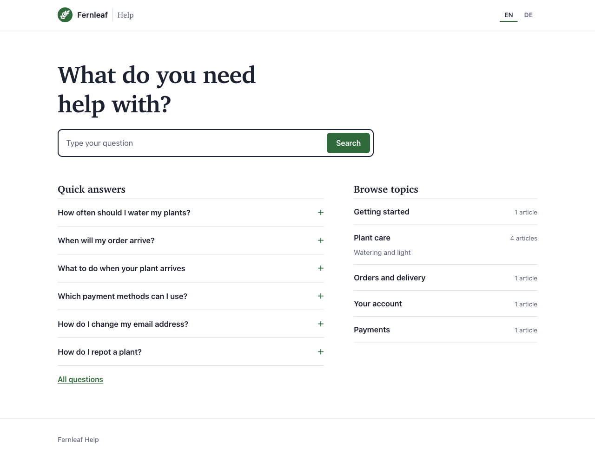
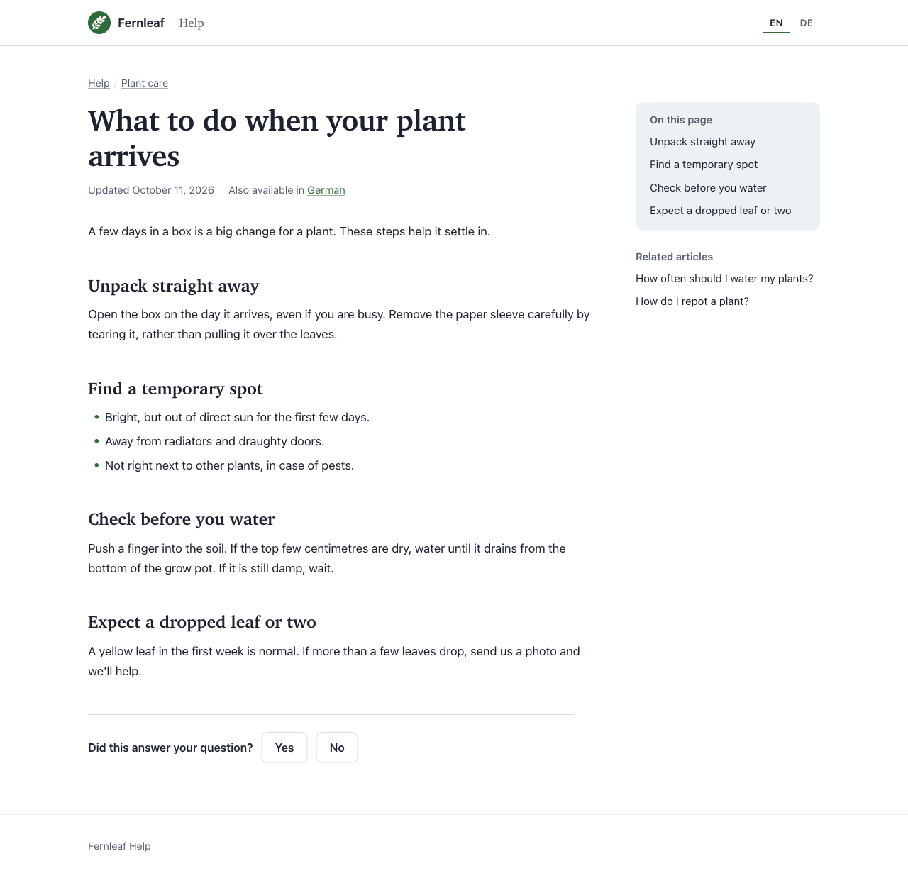
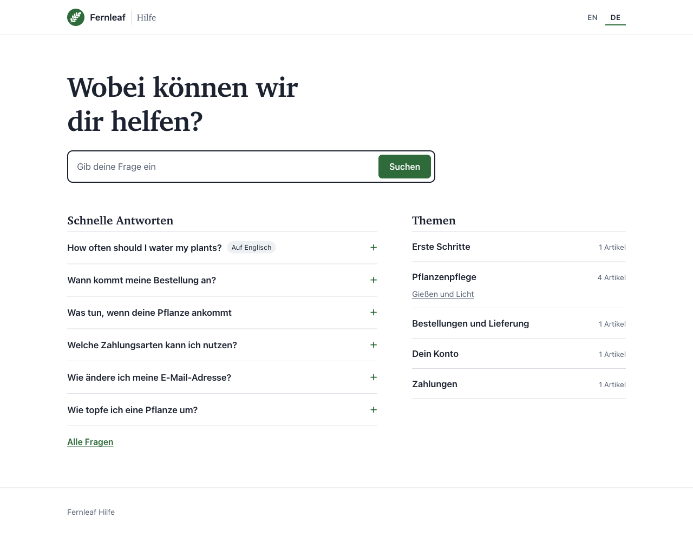
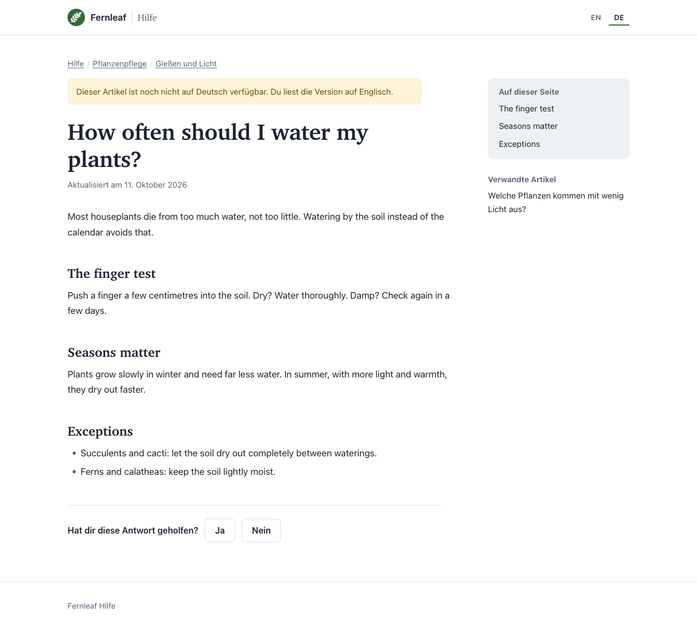
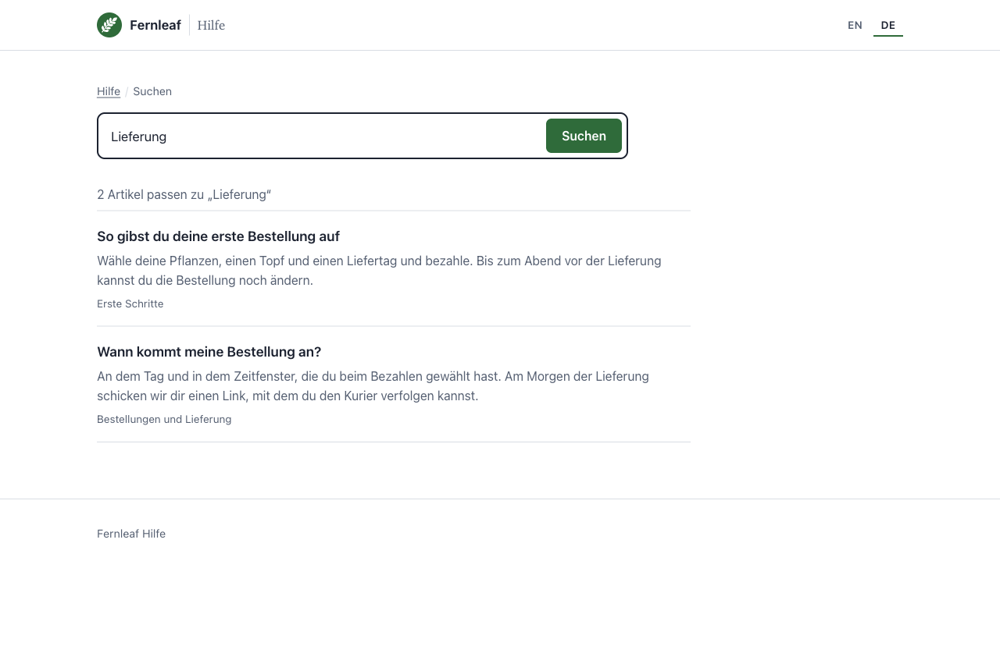

<p align="center"></p>

# Laravel Knowledge Base: Help Center

> **Demonstrator, not maintained.** This repo shows what the features below make possible together: a public, multi-language help center on top of [laravel-knowledge-base](https://github.com/jeffersongoncalves/laravel-knowledge-base). It is not published on Packagist and gets no updates; copy what you need.
>
> - Public vs staff-only visibility: [laravel-knowledge-base#15](https://github.com/jeffersongoncalves/laravel-knowledge-base/pull/15)
> - Content localization: [laravel-knowledge-base#16](https://github.com/jeffersongoncalves/laravel-knowledge-base/pull/16)
> - Collections (e.g. an FAQ) and the `HelpCenter` read API: [laravel-knowledge-base#17](https://github.com/jeffersongoncalves/laravel-knowledge-base/pull/17)
> - Admin for languages: [filament-knowledge-base#46](https://github.com/jeffersongoncalves/filament-knowledge-base/pull/46)
> - Guest/user panel visibility fix: [filament-knowledge-base#47](https://github.com/jeffersongoncalves/filament-knowledge-base/pull/47)
> - Admin for collections: [filament-knowledge-base#48](https://github.com/jeffersongoncalves/filament-knowledge-base/pull/48)
>
> The core features are released in [laravel-knowledge-base v1.1.0](https://github.com/jeffersongoncalves/laravel-knowledge-base/releases/tag/v1.1.0).

## Screenshots

Demo content: Fernleaf, a fictional plant shop (English with German translations).

| Home | Article |
|---|---|
|  |  |
| **Same home page in German** | **German reader, English-only article: fallback notice** |
|  |  |
| **Search in German** | |
|  | |

A ready-made public help center for [jeffersongoncalves/laravel-knowledge-base](https://github.com/jeffersongoncalves/laravel-knowledge-base): a search-first home page with quick answers, topic pages, articles, an FAQ page and search, in every language your knowledge base is configured for.

- Shows only content customers may see: every page goes through the core's `HelpCenter` read API, so internal articles and internal or inactive topics never appear.
- Multi-language out of the box: language switcher, `hreflang` and canonical links, redirects from a slug in the wrong language, and a clear notice when a reader gets another language (fallback) or an outdated translation.
- Interface text in English, German, French, Spanish and Dutch; add more by publishing the translations.
- "Was this helpful?" feedback, an "On this page" list for longer articles, related articles.
- No JavaScript, no build step, no web fonts. Restyle with a few CSS variables or publish the views.

See [DESIGN.md](DESIGN.md) for the design decisions.

## Requirements

- PHP 8.2+, Laravel 11 to 13
- `jeffersongoncalves/laravel-knowledge-base` 1.1 or later (content localization, collections and the `HelpCenter` read API)

## Install

Not on Packagist: add this repo as a `vcs` repository in your `composer.json` and require `rcoenen/laravel-knowledge-base-help-center:dev-main`, or copy the code into your app.

The help center is off until you switch it on:

```dotenv
KB_HELP_CENTER_ENABLED=true
```

Pages are then served at `/{locale}/help` for every language in `knowledge-base.locales`, and `/help` redirects to the reader's language.

| Page | URL |
|---|---|
| Home | `/en/help` |
| Topic | `/en/help/categories/{slug}` |
| Article | `/en/help/articles/{slug}` |
| Collection (FAQ) | `/en/help/collections/{slug}` |
| Search | `/en/help/search?q=...` |

## Configure

```bash
php artisan vendor:publish --tag=knowledge-base-help-center-config
```

| Key | Default | What it does |
|---|---|---|
| `enabled` | `false` (`KB_HELP_CENTER_ENABLED`) | Registers the routes |
| `prefix` | `help` (`KB_HELP_CENTER_PREFIX`) | The URL segment after the language |
| `middleware` | `['web']` | Route middleware |
| `route_name` | `kb-help.` | Route name prefix |
| `brand` | `config('app.name')` | Name in the header |
| `home_url` | `null` | Adds a "Back to …" link to your site |
| `custom_css` | `null` | Extra CSS added after the default styles |
| `faq_collection` | `frequently-asked-questions` | Collection shown as quick answers on the home page; `null` hides it |
| `show_outdated_notice` | `true` | Tell readers when a translation was flagged outdated |
| `feedback` | `true` | Show "Was this helpful?" |
| `search_min_length` / `search_limit` | `2` / `20` | Search behaviour |

## Restyle

Every colour and font is a CSS custom property. The quickest restyle is a few overrides:

```php
// config/knowledge-base-help-center.php
'custom_css' => ':root { --kb-accent: #0b6e4f; --kb-serif: Georgia, serif; }',
```

Available properties: `--kb-ink`, `--kb-paper`, `--kb-mist`, `--kb-rule`, `--kb-slate`, `--kb-accent`, `--kb-accent-ink`, `--kb-notice-bg`, `--kb-notice-ink`, `--kb-serif`, `--kb-sans`, `--kb-radius`, `--kb-measure`.

For full control, publish the views and change them like any Blade template:

```bash
php artisan vendor:publish --tag=knowledge-base-help-center-views
```

## Interface text

English, German, French, Spanish and Dutch are included. To change the wording or add a language:

```bash
php artisan vendor:publish --tag=knowledge-base-help-center-translations
```

and edit or add files in `lang/vendor/kb-help/{locale}/help.php`.

## Demo content

A fictional houseplant shop, in English with German translations (when `de` is in `knowledge-base.locales`), covering every reader-facing case (fallback, outdated translation, nested topics, an FAQ, and an internal article that must stay hidden):

```bash
php artisan migrate:fresh
php artisan db:seed --class="Rcoenen\KnowledgeBaseHelpCenter\Database\Seeders\HelpCenterDemoSeeder"
```

To dress it as the demo shop, as in the screenshots: set `APP_NAME=Fernleaf`, point `knowledge-base-help-center.logo` at `vendor/rcoenen/laravel-knowledge-base-help-center/resources/images/fernleaf-logo.svg`, and set `custom_css` to `.kb { --kb-accent: #2f6b3a; }`.

Use it on a development database only: `migrate:fresh` drops all tables.

## Testing

```bash
composer test
```

## License

MIT
